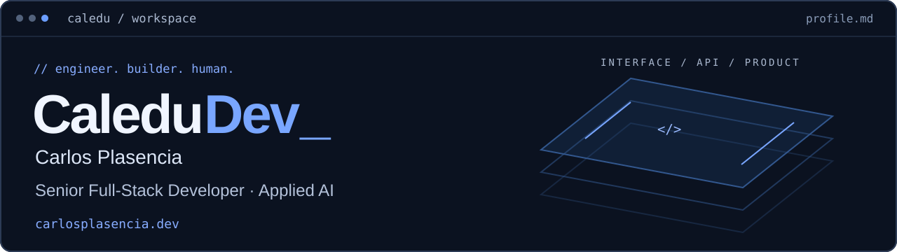

### Web products, from idea to production.

I'm **Carlos Plasencia**, also known as **CaleduDev** — a senior full-stack developer and founder of [Totora Studio](https://totora.studio/), based in Trujillo, Peru.

I design architectures, build interfaces and APIs, and take products to production. My work spans client websites, SaaS platforms and applied AI — both hands-on development and technical leadership.

**[Portfolio ↗](https://www.carlosplasencia.dev/en/)** · **[LinkedIn ↗](https://www.linkedin.com/in/carlos-edu-plasencia-prado/)** · **[Let's talk ↗](https://www.carlosplasencia.dev/en/contact/)**

## Selected work

| Project | What I built / my role |
| :--- | :--- |
| **[Financialia](https://www.carlosplasencia.dev/en/projects/financialia/)** | Personal finance app with voice and text input powered by Claude. Built end to end, with server-side validation and user confirmation before saving transactions. |
| **[Skillramp](https://www.carlosplasencia.dev/en/projects/skillramp/)** | SaaS for creating and selling online academies. Defined the architecture and led development with a cross-functional team at Aptura Labs. |
| **[DGF Inmobiliaria](https://www.carlosplasencia.dev/en/projects/dgf-inmobiliaria/)** | Designed, developed and deployed through Totora Studio. Includes a CMS, blog, ambassador and referral features, and configurable website content. |

Also built **[Maki Panda](https://www.carlosplasencia.dev/en/projects/maki-panda/)** — a restaurant website with a configurable menu and loyalty program — and **[ReservaYa](https://www.carlosplasencia.dev/en/projects/reservaya/)**, a booking and payments product for health professionals.

## My toolkit

**TypeScript · React · Next.js · Node.js · NestJS · GraphQL**

More technologies and integrations

- **Web:** Astro
- **Data:** PostgreSQL, MongoDB, Redis
- **Applied AI:** Claude integration, structured extraction and validation
- **Product integrations:** MercadoPago, WhatsApp Business API, Google Calendar

## How I build

Understand the business → design the architecture → build → validate → ship.

I use **Codex and Claude** to support development, while keeping technical decisions, validation and review human-led.

### Explore the code

**[Portfolio source ↗](https://github.com/CarlosPlasencia/portfolio)** — the bilingual, workspace-inspired site behind my portfolio.

For the other projects, the links above lead to case studies explaining the product and my contribution.

---

**Have a product to build or a team to strengthen? [Get in touch.](https://www.carlosplasencia.dev/en/contact/)**
